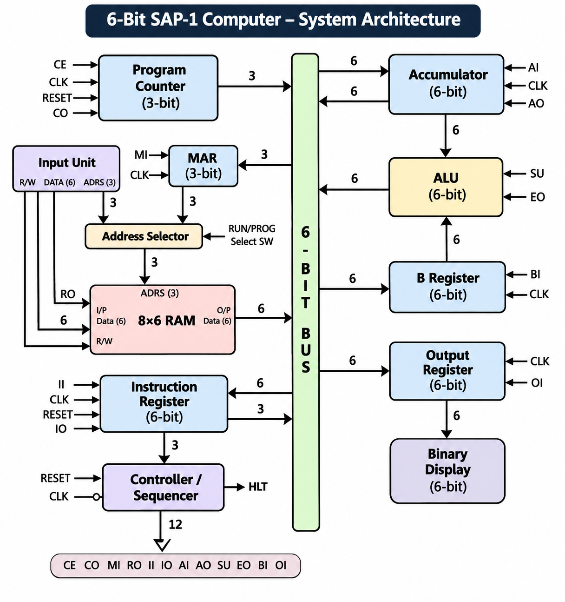

# 6-Bit SAP-1 Computer Design and Simulation in Proteus

A modular implementation and simulation of a **6-bit SAP-1 (Simple-As-Possible-1) computer** developed in Proteus Design Suite. The project demonstrates the fundamental operation of a simple computer through interconnected registers, memory, arithmetic logic, control circuitry, clock generation, instruction execution, and shared-bus communication.

The system was developed progressively as a team project, beginning with individual functional modules and concluding with their integration into a complete SAP-1 computer.

---

## 1. Project Overview

SAP-1 is a simplified computer architecture designed to demonstrate the fundamental organization and operation of a digital computer.

This project implements a **6-bit SAP-1 computer architecture** using digital logic circuits in Proteus. Rather than treating the computer as a single circuit, the architecture was divided into individual functional modules that were designed, simulated, and subsequently integrated into the complete system.

The major modules include:

- Clock Pulse Generator
- Program Counter
- Input Unit
- Address Selector
- Memory Address Register (MAR)
- Random Access Memory (RAM)
- Accumulator
- B Register
- Arithmetic and Logic Unit (ALU)
- Instruction Register
- Controller-Sequencer
- Output Register

The complete system coordinates these modules through a shared bus and a set of control signals generated by the Controller-Sequencer.

---

## 2. Project Objectives

The primary objectives of the project were to:

- Understand the internal architecture and operation of a basic stored-program computer
- Design a 6-bit SAP-1 computer using digital logic components
- Design and test the major computer modules independently
- Implement register-based data storage and transfer
- Implement memory addressing and instruction storage
- Design a shared bus for communication between modules
- Implement binary addition and subtraction using an ALU
- Design a Controller-Sequencer for coordinated control-signal generation
- Implement the instruction fetch and execution process
- Integrate the individual modules into a complete SAP-1 computer
- Verify the operation of individual modules and the integrated system through Proteus simulation
- Develop PCB layouts for selected modules

---

## 3. System Architecture

The implemented SAP-1 computer follows a modular architecture in which memory, registers, arithmetic circuitry, instruction-processing circuitry, and the output subsystem communicate through a shared system bus.

The **Controller-Sequencer** coordinates the operation of these modules by generating the control signals required for data transfer and instruction execution.



The architecture can be summarized as:

```text
Program Counter
      │
      ▼
Memory Address Register
      │
      ▼
     RAM
      │
      ▼
System Bus ◄──────────────► Instruction Register
    ▲   ▲                         │
    │   │                         ▼
    │   │                  Controller-Sequencer
    │   │                         │
    │   └──── Control Signals ────┘
    │
    ├────────► Accumulator
    │               │
    │               ▼
    │              ALU ◄──── B Register
    │               │
    │               ▼
    └────────── System Bus
                    │
                    ▼
              Output Register
```

---

## 4. Development Phases

The computer was developed progressively across multiple project phases.

### 4.1 Phase A — Clock and Program Counter

The initial phase focused on the timing and instruction-addressing mechanisms of the computer.

The **Clock Pulse Generator** provides the timing reference required to synchronize sequential operations throughout the system.

The **Program Counter** stores the address associated with the next instruction and advances as program execution progresses.

### 4.2 Phase B — Memory and Data Registers

The second phase introduced the primary memory and data-storage modules:

- Input Unit
- Memory Address Register
- Accumulator
- B Register
- Output Register
- RAM

These components established the basic datapath required for storing and transferring information throughout the computer.

### 4.3 Phase C — Instruction and Control Units

The next stage introduced the instruction-processing circuitry:

- Instruction Register
- Controller-Sequencer

The Instruction Register stores the currently fetched instruction, while the Controller-Sequencer generates the control signals required to execute that instruction.

### 4.4 Phase D — ALU and Bus Integration

The arithmetic subsystem and common data bus were incorporated during this stage.

The ALU performs binary addition and subtraction, while the shared bus enables controlled data transfer between the computer's modules.

### 4.5 Phase E — Complete System Integration

The final stage combined the independently designed modules into the complete SAP-1 computer.

The integrated system brings together:

- Clock generation
- Instruction addressing
- Memory access
- Instruction storage
- Instruction decoding
- Control-signal generation
- Register transfers
- Arithmetic operations
- Bus communication
- Output handling

---

## 5. Major Functional Modules

### 5.1 Clock Pulse Generator

The Clock Pulse Generator provides the timing signal required to synchronize sequential operations throughout the computer.

It controls the timing of registers, counters, and the Controller-Sequencer so that operations occur in the required sequence.


---

### 5.2 Program Counter

The Program Counter maintains the address required for sequential instruction execution.

Its primary control signals include:

- **CE — Counter Enable:** advances the Program Counter
- **CO — Counter Out:** places the counter value onto the appropriate data path

During instruction fetching, the Program Counter supplies the address of the instruction to be accessed from memory.


---

### 5.3 Input Unit

The Input Unit provides the mechanism for entering information into the memory subsystem during programming.

It works together with the Address Selector to allow memory locations and corresponding data to be configured before program execution.


---

### 5.4 Address Selector

The Address Selector determines which address source is connected to the memory system.

Depending on the operating mode, the memory address can originate from:

- the Input Unit during programming, or
- the Memory Address Register during execution.

This allows the same RAM subsystem to support both program loading and program execution.


---

### 5.5 Memory Address Register (MAR)

The Memory Address Register stores the address of the RAM location currently being accessed.

During program execution, an address can be transferred to the MAR as part of either the instruction-fetch process or an instruction requiring memory access.

The **MI (Memory Address In)** control signal enables the MAR to capture the required address.


---

### 5.6 Random Access Memory (RAM)

The RAM stores the instructions and data required during program execution.

The selected memory location is determined by the address supplied through the memory-addressing circuitry.

The **RO (RAM Out)** control signal enables the contents of the selected memory location to participate in a data transfer.


---

### 5.7 Accumulator

The Accumulator, or A Register, is the primary working register of the computer.

It stores operands and intermediate arithmetic results and is directly connected to the arithmetic subsystem.

Its primary control signals include:

- **AI — Accumulator In**
- **AO — Accumulator Out**

AI allows the Accumulator to capture incoming data, while AO enables its stored value to participate in a bus transfer.


---

### 5.8 B Register

The B Register stores the second operand required for arithmetic operations.

During arithmetic instructions, data retrieved from memory can be loaded into the B Register before being processed together with the Accumulator value by the ALU.

The **BI (B Register In)** control signal enables data to be loaded into the register.


---

### 5.9 Arithmetic and Logic Unit (ALU)

The **6-bit ALU** performs the arithmetic operations required by the implemented computer.

The arithmetic circuitry supports:

- Binary addition
- Binary subtraction

Subtraction is implemented using the **two's-complement method**.

The principal ALU-related control signals include:

- **SU — Add/Subtract Select**
- **EO — ALU Out**

When subtraction is selected, the appropriate complement/carry behavior is introduced to perform two's-complement subtraction.

EO enables the ALU result to be transferred for subsequent storage or processing.


---

### 5.10 Instruction Register

The Instruction Register stores the instruction retrieved from RAM during the fetch process.

The stored instruction provides the information required by the control circuitry to determine the operation to be executed and, where applicable, the associated memory address.

Relevant control signals include:

- **II — Instruction Register In**
- **IO — Instruction Register Out**

II loads an instruction into the register, while IO enables the required instruction information to participate in subsequent operations.


---

### 5.11 Controller-Sequencer

The Controller-Sequencer coordinates the operation of the complete computer.

It interprets instruction information and generates the control signals required to activate the appropriate modules at the correct points in the execution sequence.

The primary control signals used by the system are:

```text
CE  CO  MI  RO  II  IO  AI  AO  SU  EO  BI  OI
```

A separate **HLT** signal is used for halting program execution.


---

### 5.12 Output Register

The Output Register stores the final value intended for output.

The **OI (Output In)** control signal enables the register to capture the appropriate value during execution.

The stored result can subsequently be presented through the associated output/display circuitry.


---

## 6. Shared Bus and Data Transfer

The individual functional modules communicate through a shared bus architecture.

Since several modules are connected to the same communication path, their outputs must be controlled to prevent multiple incompatible outputs from driving the bus simultaneously.

Tri-state interfacing is used where required to control access to the shared data path.

A typical register-transfer operation follows this sequence:

1. The appropriate source module is enabled.
2. The source places its stored value onto the bus.
3. The destination module's input control is activated.
4. The destination captures the bus value at the appropriate clock transition.

This allows multiple modules to share a common communication path while maintaining controlled data movement.

---

## 7. Instruction Set

The implemented computer uses a compact instruction set for demonstrating memory access, arithmetic operations, output, and program control.

| Instruction | Operation | Function |
|---|---|---|
| `LDA` | Load Accumulator | Loads data from the specified memory location into the Accumulator |
| `ADD` | Addition | Adds data from memory to the current Accumulator value |
| `SUB` | Subtraction | Subtracts memory data from the current Accumulator value |
| `OUT` | Output | Transfers the Accumulator value to the Output Register |
| `HLT` | Halt | Stops program execution |

This instruction set is sufficient to demonstrate the basic **fetch–decode–execute cycle** of the computer.

---

## 8. Fetch–Decode–Execute Cycle

Program execution is performed through a sequence of coordinated register-transfer operations.

### 8.1 Fetch

During the fetch stage:

1. The Program Counter provides the address of the next instruction.
2. The address is transferred to the Memory Address Register.
3. RAM accesses the selected memory location.
4. The instruction stored at that location is transferred to the Instruction Register.
5. The Program Counter advances for the next instruction.

### 8.2 Decode

The instruction stored in the Instruction Register is supplied to the Controller-Sequencer.

The Controller-Sequencer determines which sequence of control signals is required for the instruction.

### 8.3 Execute

The required control signals activate the relevant modules.

Depending on the instruction, execution can involve:

- accessing a memory location,
- loading the Accumulator,
- loading the B Register,
- performing an ALU operation,
- transferring an arithmetic result,
- loading the Output Register, or
- halting execution.

---

## 9. Control Sequencing

The implemented Controller-Sequencer organizes the principal instruction operations using **five T-states**.

| T-State | LDA | ADD | SUB | OUT |
|---|---|---|---|---|
| **T1** | CO, MI | CO, MI | CO, MI | CO, MI |
| **T2** | CE, RO, II | CE, RO, II | CE, RO, II | CE, RO, II |
| **T3** | IO, MI | IO, MI | IO, MI | AO, OI |
| **T4** | RO, AI | RO, BI | RO, BI | — |
| **T5** | — | EO, AI | EO, AI, SU | — |

The initial T-states perform the common instruction-fetch operations. The subsequent states depend on the instruction being executed.

This sequencing coordinates memory access, register transfers, arithmetic operations, and output operations in the required order.

---

## 10. Complete System Integration

After the individual modules were designed and tested, they were connected to form the complete 6-bit SAP-1 computer.


The final integrated design combines:

- Clock generation
- Program counting
- Memory addressing
- RAM
- Instruction storage
- Instruction decoding
- Control sequencing
- Accumulator and B Register
- 6-bit arithmetic operations
- Shared-bus communication
- Output storage

The complete Proteus project is available here:

[Open the Complete SAP-1 Proteus Project](proteus/final-system/SAP_1_Computer_Team_ReVOLT.pdsprj)

---

## 11. Simulation and Verification

Each functional module was designed and simulated individually before complete system integration.

This modular development approach allowed individual components to be verified independently before connecting them to the complete architecture.

The repository includes screenshots of all individual Proteus modules as well as the final integrated system.

### Module Simulation Screenshots

| Module | Screenshot |
|---|---|
| Address Selector | [View](results/figures/address_selector.png) |
| Accumulator | [View](results/figures/accumulator.png) |
| ALU | [View](results/figures/alu.png) |
| B Register | [View](results/figures/b_register.png) |
| Clock Pulse Generator | [View](results/figures/clock.png) |
| Controller-Sequencer | [View](results/figures/control_sequencer.png) |
| Input Unit | [View](results/figures/input_unit.png) |
| Instruction Register | [View](results/figures/instruction_register.png) |
| Memory Address Register | [View](results/figures/mar.png) |
| Output Register | [View](results/figures/output_register.png) |
| Program Counter | [View](results/figures/program_counter.png) |
| RAM | [View](results/figures/ram.png) |
| Complete SAP-1 Computer | [View](results/figures/final_system.png) |

The individual screenshots provide a direct view of the circuit-level implementation without requiring Proteus to inspect the architecture.

---

## 12. Proteus Project Files

The repository includes the original Proteus project for each major subsystem.

| Module | Proteus Project |
|---|---|
| Address Selector | [Address_Selector.pdsprj](proteus/modules/Address_Selector.pdsprj) |
| Accumulator | [Accumulator.pdsprj](proteus/modules/Accumulator.pdsprj) |
| ALU | [ALU.pdsprj](proteus/modules/ALU.pdsprj) |
| B Register | [B_Register.pdsprj](proteus/modules/B_Register.pdsprj) |
| Clock Pulse Generator | [Clock.pdsprj](proteus/modules/Clock.pdsprj) |
| Controller-Sequencer | [Control_Sequencer.pdsprj](proteus/modules/Control_Sequencer.pdsprj) |
| Input Unit | [Input_Unit.pdsprj](proteus/modules/Input_Unit.pdsprj) |
| Instruction Register | [Instruction_Register.pdsprj](proteus/modules/Instruction_Register.pdsprj) |
| Memory Address Register | [MAR.pdsprj](proteus/modules/MAR.pdsprj) |
| Output Register | [Output_Register.pdsprj](proteus/modules/Output_Register.pdsprj) |
| Program Counter | [Program_Counter.pdsprj](proteus/modules/Program_Counter.pdsprj) |
| RAM | [RAM.pdsprj](proteus/modules/RAM.pdsprj) |

The complete integrated system is provided separately:

[**SAP_1_Computer_Team_ReVOLT.pdsprj**](proteus/final-system/SAP_1_Computer_Team_ReVOLT.pdsprj)

---

## 13. Technologies and Components

### Software

- Proteus Design Suite

### Engineering Concepts

- Digital logic design
- Computer architecture
- Register-transfer operations
- Sequential logic
- Combinational logic
- Shared-bus architecture
- Binary arithmetic
- Two's-complement subtraction
- Instruction sequencing
- Control-unit design
- PCB design

### Representative Digital Components

The project uses standard digital ICs and logic components to implement registers, arithmetic operations, bus interfacing, timing, and control circuitry.

Components documented during the project include:

- 74HC173 D-type registers
- 74HC245 bus transceivers
- 74HC283 binary adders
- 555 timer circuitry
- Logic gates
- Counter circuitry
- Register circuitry
- Tri-state interfacing

---

## 14. How to Run

### Requirements

- Proteus Design Suite

### Complete System

Clone or download the repository and navigate to:

```text
proteus/final-system/
```

Open:

```text
SAP_1_Computer_Team_ReVOLT.pdsprj
```

in Proteus Design Suite.

Start the simulation and observe the interaction between the computer's registers, memory, ALU, control circuitry, and output subsystem.

### Individual Modules

Individual functional modules can be opened separately from:

```text
proteus/modules/
```

This allows each subsystem to be inspected and simulated independently.

---

## 15. Project Structure

```text
sap-1-computer-proteus/
│
├── README.md
├── .gitignore
│
├── proteus/
│   ├── final-system/
│   │   └── SAP_1_Computer_Team_ReVOLT.pdsprj
│   │
│   └── modules/
│       ├── Address_Selector.pdsprj
│       ├── Accumulator.pdsprj
│       ├── ALU.pdsprj
│       ├── B_Register.pdsprj
│       ├── Clock.pdsprj
│       ├── Control_Sequencer.pdsprj
│       ├── Input_Unit.pdsprj
│       ├── Instruction_Register.pdsprj
│       ├── MAR.pdsprj
│       ├── Output_Register.pdsprj
│       ├── Program_Counter.pdsprj
│       └── RAM.pdsprj
│
├── documentation/
│   ├── ReVOLT_Phase_A_B_Project_Report.pdf
│   └── ReVOLT_Phase_C_D_E_Project_Report.pdf
│
└── results/
    └── figures/
        ├── system_architecture.png
        ├── address_selector.png
        ├── accumulator.png
        ├── alu.png
        ├── b_register.png
        ├── clock.png
        ├── control_sequencer.png
        ├── input_unit.png
        ├── instruction_register.png
        ├── mar.png
        ├── output_register.png
        ├── program_counter.png
        ├── ram.png
        └── final_system.png
```

---

## 16. Documentation

Detailed design, implementation, simulation results, PCB layouts, component descriptions, and project discussions are available in the original project reports:

- [Phase A & B Project Report](documentation/ReVOLT_Phase_A_B_Project_Report.pdf)
- [Phase C, D & E Project Report](documentation/ReVOLT_Phase_C_D_E_Project_Report.pdf)

---

## 17. Project Scope

This project was developed as an **educational implementation of a 6-bit SAP-1 computer architecture**.

The primary purpose was to understand and implement fundamental computer-architecture concepts at the digital-logic level, including:

- register-transfer operations,
- shared-bus communication,
- memory addressing,
- instruction fetching,
- instruction decoding,
- binary arithmetic,
- control sequencing,
- and coordinated operation of digital hardware.

The architecture is intentionally simple and is intended for educational exploration of computer organization rather than use as a modern general-purpose processor.

---

## 18. Contributors and Individual Contribution

This project was developed collaboratively by **Team ReVOLT** at the **Islamic University of Technology (IUT)**.

### Team Members

- Mashrur Saad Emad
- Sumaiya Aziz
- Tashfia Islam
- Mysha Rubaba
- Taufeeq Hassan Omio
- Ishrak Anan
- Nafis Islam Fardin

**Supervisor:** Mirza Fuad Adnan

### My Contribution

My documented contributions across the project phases included:

- Accumulator implementation
- Instruction Register implementation
- PCB design/layout of the Program Counter
- PCB design/layout of the Accumulator
- PCB design/layout of the B Register
- PCB design/layout of the Output Register
- PCB design/layout of the Instruction Register
- PCB design/layout of the ALU
- Project report preparation

The complete SAP-1 computer was developed collaboratively by Team ReVOLT, while the items above represent my individually documented contributions to the project.

---

## 19. Repository Maintainer

**Mashrur Saad Emad**  
Electrical and Electronic Engineering Graduate  
Islamic University of Technology (IUT)

[GitHub Profile](https://github.com/mashrursaademad)  
[LinkedIn Profile](https://www.linkedin.com/in/mashrur-saad-emad-787995436/)
